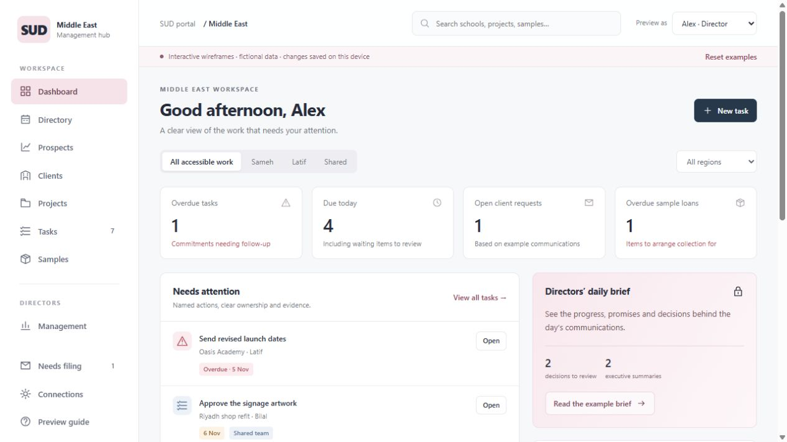

# SUD Middle East Management Hub - design preview

An open, interactive review version for Alex and Bilal. This repository contains the public preview only.

## Review

Open the live preview: https://schooluniformdirect.github.io/sud-me-crm-preview/ . Switch **Preview as** between Alex, Bilal, Sameh and Latif to explore the proposed views. Try the dashboard, directory, prospects, clients, projects, tasks, communications and samples.

Use **Leave feedback** in the preview, or the repository's Issues tab. A GitHub account is required to submit feedback. Please identify the page, what you expected and the change you would like. Feedback is public: do not include real client details, email content or confidential prices.

## Preview limits

All client records, communications and sample movements are fictional examples. Changes are saved in your own browser and are not shared with other reviewers. Reset examples restores the starting data. Email and production integrations are not connected. The persona switch demonstrates intended views; it is not authentication or a security boundary.

To review offline, download the repository ZIP, extract it and open **SUD_ME_Interactive_Wireframes.html** in a modern browser. No installation is required.

## Publishing

GitHub Pages serves the root of the main branch. Updates to this repository publish to the same review URL. This repository must contain demonstration assets only. Production CRM source, business data and credentials belong in a separate private repository and secured application.

